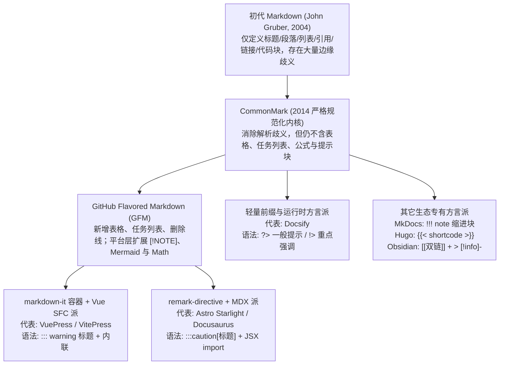

# Markdown 方言谱系：为什么“同为 `*.md`”却无法跨框架通用？

文件后缀名虽然都叫 `.md`，但在现代静态网站生成（SSG）领域，**并不存在唯一的“标准技术文档 Markdown”**。初代 Markdown 只定义了最基础的散文排版，而现代技术文档必需的**表格、提示框（Callouts）、折叠块、数学公式、流程图与交互组件**全部由后来的各个社区各自扩展，最终演化出互不兼容的**五大方言派系**。



---

## 1. 第一层：基础 Markdown 与 CommonMark（最大公约数内核）

- **包含内容**：标题 `#`、粗斜体 `**` / `*`、无序/有序列表、基础块引用 `>`、超链接 `[text](url)`、图片 ``、围栏代码块 ```` ``` ```` 以及原生内联 HTML。
- **核心局限**：为了保持极简，CommonMark **没有任何关于表格、元数据（Frontmatter）、提示框、脚注或数学公式的定义**。如果只写严格 CommonMark，虽然任何工具都能打开，但根本无法满足工程技术文档的表达需求。

---

## 2. 第二层：GitHub Flavored Markdown（GFM · 事实上的通用母版）

GitHub 在 CommonMark 基础上制定了 GFM 规范，并在 GitHub.com 网页渲染器中持续加入高频特性，使其成为当今开发者默认的“通用基准”（**本站 `docs/*.md` 母版即严格采用此层语法**）：

1. **GFM 正式语法扩展**：管道符表格（`| a | b |`）、任务列表（`- [x] done`）、删除线（`~~text~~`）、裸 URL 自动链接。
2. **GitHub 平台级扩展**：
   - **五类引用警报（Alerts）**：`> [!NOTE]`、`> [!TIP]`、`> [!IMPORTANT]`、`> [!WARNING]`、`> [!CAUTION]`；
   - **原生图表代码块**：```` ```mermaid ```` 直接渲染为交互式矢量图；
   - **原生数学公式**：`$...$` 与 `$$...$$`（由 MathJax 引擎支持）。
3. **跨框架落差**：很多开发者误以为 GitHub 能渲染的语法就是所有 `.md` 的标准——实际上把包含 `> [!CAUTION]` 和 ```` ```mermaid ```` 的 GFM 文档直接丢进未加插件的 Starlight、VitePress 或旧版 VuePress，要么样式全无，要么变成死代码块。

---

## 3. 第三层：同为“三冒号 `:::`”，为何裂变成两派？

这是跨 SSG 迁移文档最常踩坑的重灾区——表面都用 `:::`，底层却分属两套完全不同的解析器生态：

| 对比项 | `markdown-it-container` 方言派 | `remark-directive` 指令提案派 |
| :--- | :--- | :--- |
| **代表框架** | **VuePress (v1/v2)**、**VitePress (v1/v2)**、Hexo | **Astro Starlight**、**Docusaurus**、MyST |
| **空格规则** | `:::` 后通常加空格：`::: tip` | `:::` 后紧贴指令名：`:::tip` |
| **自定义标题写法** | 直接跟在空格后：`::: warning 升级注意` | **必须包裹在方括号内**：`:::caution[升级注意]` |
| **警告关键字** | `warning` / `danger` | Starlight 为 `caution` / `danger` |
| **折叠容器** | 原生提供 `::: details 点击展开` | 无内置 `:::details`，改用 HTML `<details>` |

> [!WARNING]
> 若将 VitePress 的 `::: tip 自定义标题` 原样复制到 Astro Starlight 中，由于没有用 `[自定义标题]` 方括号包裹，自定义标题会被静默丢弃！

---

## 4. 第四层：组件内嵌方言（Vue-in-Markdown vs MDX）

当静态文本无法满足复杂排版（如多栏卡片、标签页切换）时，两大现代前端阵营走上了截然不同的混合编译路线：

- **Markdown-as-Vue-SFC（VuePress / VitePress）**：
  - 整篇 `.md` 直接被编译为一个 Vue 单文件组件，支持在 `.md` 中直接写 `<script setup>` 与全局组件 `<Badge type="tip" text="v1" />`。
  - **副作用**：正文中若出现未包裹在反引号里的伪泛型标签（如 `Array<string>` 或 `<T>`），会被 Vue 模板编译器误认为未知 HTML/Vue 组件甚至导致编译报错。
- **MDX（`.mdx` — Astro Starlight / Docusaurus / Nextra）**：
  - 将 Markdown 与严格 **JSX** 融合，通常使用专门的 `.mdx` 文件后缀，必须显式编写 `import { Card } from '@astrojs/starlight/components'`。
  - **副作用**：内联 HTML 必须遵守 JSX 规则——标准 HTML 注释 `<!-- 注释 -->` 非法（必须改为 `{/* 注释 */}`），正文里裸写的花括号 `{variable}` 会被当作 JavaScript 表达式求值而直接报 `ReferenceError`！

---

## 5. 第五层：轻量运行时与其它主流生态方言对照

同一句“带自定义标题的警告框”，在七种不同 Markdown 方言中的真实写法对比如下：

```markdown
<!-- 1. CommonMark 基础兼容写法 -->
> **升级注意**：请先备份配置文件。

<!-- 2. GitHub Flavored Markdown (GFM 母版写法) -->
> [!WARNING]
> **升级注意**：请先备份配置文件。

<!-- 3. VitePress / VuePress (markdown-it 容器方言) -->
::: warning 升级注意
请先备份配置文件。
:::

<!-- 4. Astro Starlight (remark-directive 指令方言) -->
:::caution[升级注意]
请先备份配置文件。
:::

<!-- 5. Docsify (专有前缀方言) -->
!> **升级注意**：请先备份配置文件。

<!-- 6. MkDocs Material (Python-Markdown 4 空格缩进方言，无需闭合标签) -->
!!! warning "升级注意"
    请先备份配置文件。

<!-- 7. Hugo (Go Template Shortcode 短代码方言) -->

请先备份配置文件。

```

---

## 6. 第六层：新兴混合方言与跨出 Markdown 边界（MDC / WikiLinks / MyST / AsciiDoc）

随着静态文档工程进一步分化，近年又出现了四类极具代表性的演进路线：

1. **MDC 语法（Nuxt Content）**：使用双冒号 `::alert{type="warning"}` 直接在纯 `.md` 中传递 Props 并映射 Vue 组件，避免了 MDX 中裸写花括号 `{}` 报错的问题。
2. **双链数字花园方言（Quartz 4 / Obsidian）**：围绕 `[[双向链接#锚点|别名]]`、`![[嵌入笔记]]` 与思维图谱构建非线性个人知识网络。
3. **MyST Markdown（Sphinx 科学出版体系）**：为了将 Python 传统霸主 Sphinx（原生采用 `reStructuredText` `.rst`）引入 Markdown 世界，Executable Books 社区设计了围栏指令语法 ```` ```{warning} ```` 与角色语法 `{ref}`，兼顾交叉引用严谨性与 Markdown 可读性。
4. **彻底跨出 Markdown 边界 —— AsciiDoc（Antora）**：在超大型多仓库企业级手册（如 Fedora、 Couchbase）中，Antora（官方托管于 GitLab `gitlab.com/antora/antora`）直接放弃了分裂的 Markdown 方言，全面采用原生内置条件宏、跨仓 `xref:` 引用、复杂跨行表格与五类标准警示块的 **AsciiDoc（`*.adoc`）**。

这正是本站坚持 **「以纯正 GFM 作为母版（`docs/*.md`），各子模块独立派生并并排展示源码差异」** 的原因：唯有看清方言边界，才能在选型时评估真实的文档资产锁定风险（Vendor Lock-in）。
